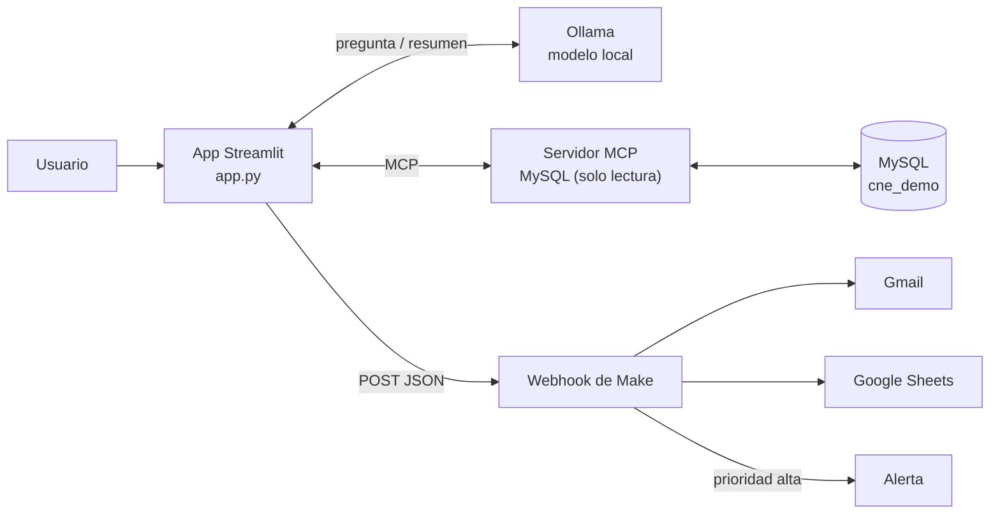

# Solicitudes ciudadanas → Make

Demo educativa para una clase de automatizaciones con [Make](https://www.make.com). Una app en Python (Streamlit) permite consultar una base MySQL en lenguaje natural mediante un modelo de IA local (Ollama) conectado por **MCP**, y enviar la solicitud elegida a un escenario de Make que notifica por correo y la registra en Google Sheets.

> Proyecto de ejemplo con **datos 100% ficticios**. No es un sistema oficial de ninguna institución.

## Cómo funciona



1. El usuario escribe una pregunta en español.
2. El modelo recibe la estructura de la base y decide qué `SELECT` ejecutar.
3. La app ejecuta la consulta en MySQL a través del servidor MCP y muestra la tabla.
4. El usuario elige una solicitud y la app la envía como JSON al webhook de Make.
5. Make ejecuta el escenario: correo, bitácora y alerta si es urgente.

Make **no se conecta a MySQL**: solo recibe los datos que la app le envía.

## Ahorro de tokens

El modelo nunca lee la base completa: solo ve el texto que la app le envía. La app reduce ese texto así:

| Técnica | Dónde en `app.py` |
|---|---|
| **Contexto una sola vez.** El diccionario de datos (tablas, columnas, tipos y comentarios) se lee de `information_schema` y queda en caché mientras corre la app. El modelo no gasta vueltas explorando la base. | `diccionario_de_datos()` |
| **Prefijo fijo y cacheable.** Instrucciones y estructura van primero y no cambian entre preguntas; es la parte que los proveedores en la nube cachean (*prompt caching*). | `preguntar()` |
| **Solo un resumen vuelve al modelo.** La tabla completa se muestra en pantalla; al modelo le llegan el número de filas y una muestra de 5. | `resumen_para_modelo()` |
| **La base hace el trabajo.** Se le pide al modelo columnas concretas, `COUNT/GROUP BY` para totales y `LIMIT`. | `INSTRUCCIONES` |
| **Consultas frecuentes sin IA.** Las preguntas habituales van directo a MySQL: 0 tokens. | `CONSULTAS_FRECUENTES` |

La app muestra los tokens de entrada y salida de cada consulta con IA, para comparar.

## Requisitos

- Python 3.10 o superior
- Node.js 18 o superior (para ejecutar el servidor MCP con `npx`)
- MySQL 8
- [Ollama](https://ollama.com) con un modelo que soporte herramientas (por defecto `qwen3:8b`, unos 5 GB)
- Una cuenta de Make (el plan gratuito alcanza)

## Instalación

```bash
git clone <url-de-este-repo>
cd <carpeta-del-repo>
python3 -m venv .venv
source .venv/bin/activate
pip install -r requirements.txt
```

**Base de datos.** Edita la clave de `cne_lector` en `schema.sql` y carga el archivo:

```bash
mysql -u root < schema.sql
```

Crea la base `cne_demo`, la tabla `solicitudes` con 15 filas ficticias y un usuario de **solo lectura** para el MCP.

**Modelo local:**

```bash
ollama pull qwen3:8b
```

**Variables de entorno.** Copia el ejemplo y completa tus valores:

```bash
cp .env.example .env
```

| Variable | Valor |
|---|---|
| `OLLAMA_MODEL` | Modelo de Ollama (por defecto `qwen3:8b`) |
| `MAKE_WEBHOOK_URL` | URL del Custom webhook de tu escenario en Make |
| `MYSQL_HOST`, `MYSQL_PORT` | `127.0.0.1` y `3306` para MySQL local |
| `MYSQL_USER`, `MYSQL_PASS` | `cne_lector` y la clave que pusiste en `schema.sql` |
| `MYSQL_DB` | `cne_demo` |

**Escenario de Make.** Sigue [make_escenario.md](make_escenario.md) para crear el webhook, Gmail, Google Sheets y el Router.

## Uso

```bash
streamlit run app.py
```

- **Consultar con IA:** escribe una pregunta, por ejemplo *"Muéstrame las solicitudes de prioridad alta que siguen pendientes"*.
- **Consultas frecuentes:** en la barra lateral, sin IA.
- **Enviar a Make:** elige una solicitud, escribe un correo de destino en la barra lateral y pulsa el botón.
- **Plan B:** datos de ejemplo para mostrar el flujo sin MySQL ni modelo.

## Seguridad

- El servidor MCP usa un usuario MySQL con permiso **solo `SELECT`**: la IA no puede modificar ni borrar datos.
- Todo corre en local: MySQL, MCP y el modelo. Solo sale a internet el JSON que se envía a Make.
- Una persona elige qué solicitud enviar; la IA no dispara acciones por su cuenta.
- La URL del webhook funciona como una contraseña: va en `.env`, que está en `.gitignore`.
- El servidor MCP ([`@benborla29/mcp-server-mysql`](https://www.npmjs.com/package/@benborla29/mcp-server-mysql)) es de terceros. Para un uso real, revisa su código y fija una versión.
- Con datos reales de personas, revisa la normativa y la política de tu institución antes de usar servicios externos.

## Archivos

| Archivo | Contenido |
|---|---|
| `app.py` | App Streamlit: IA + MCP + envío a Make |
| `schema.sql` | Base, tabla con comentarios, datos ficticios y usuario de solo lectura |
| `make_escenario.md` | Guía para armar el escenario en Make |
| `guion_clase.md` | Guion de la clase de 60 minutos |
| `.env.example` | Plantilla de variables de entorno |
